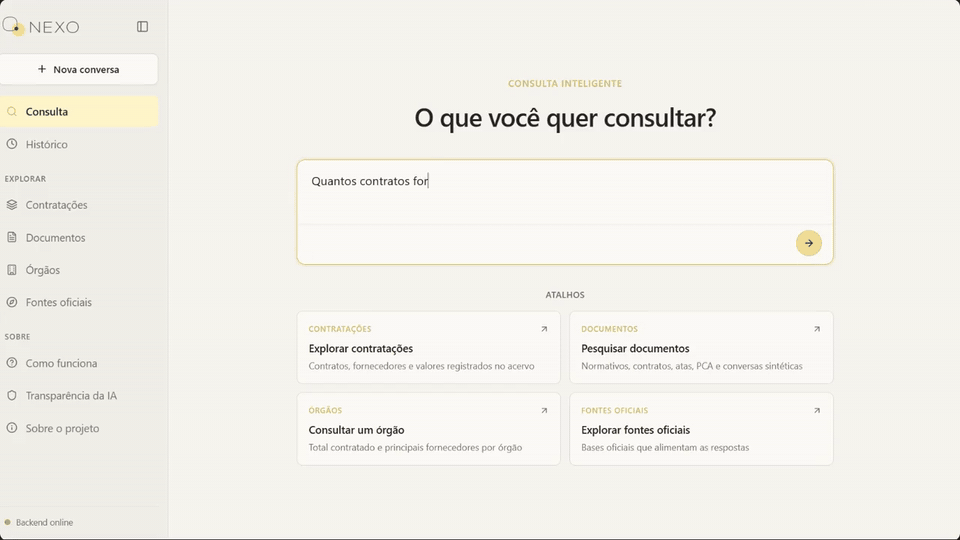
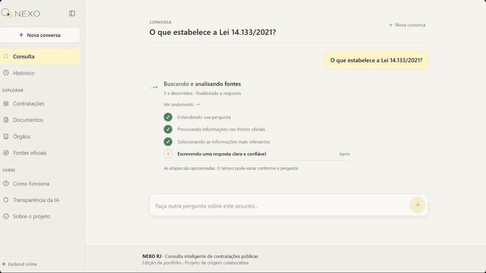
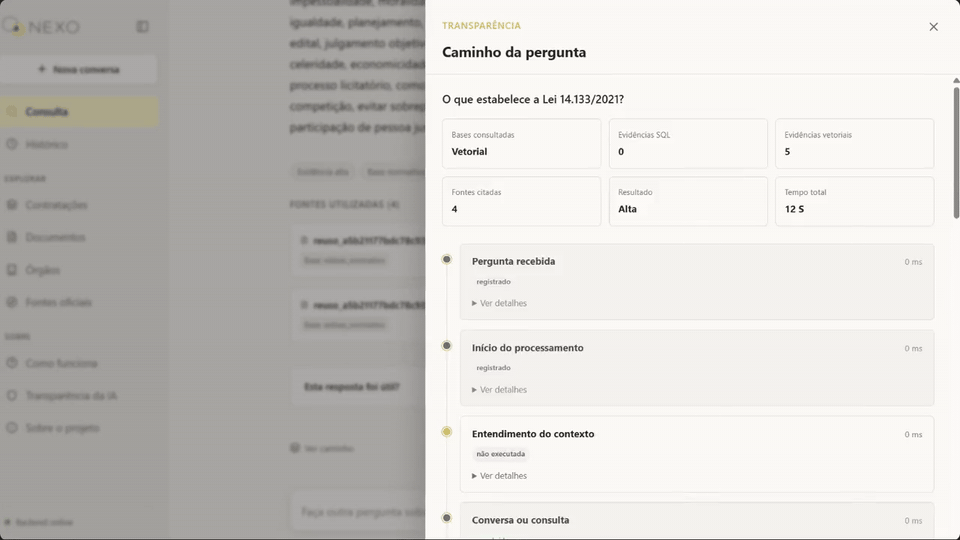
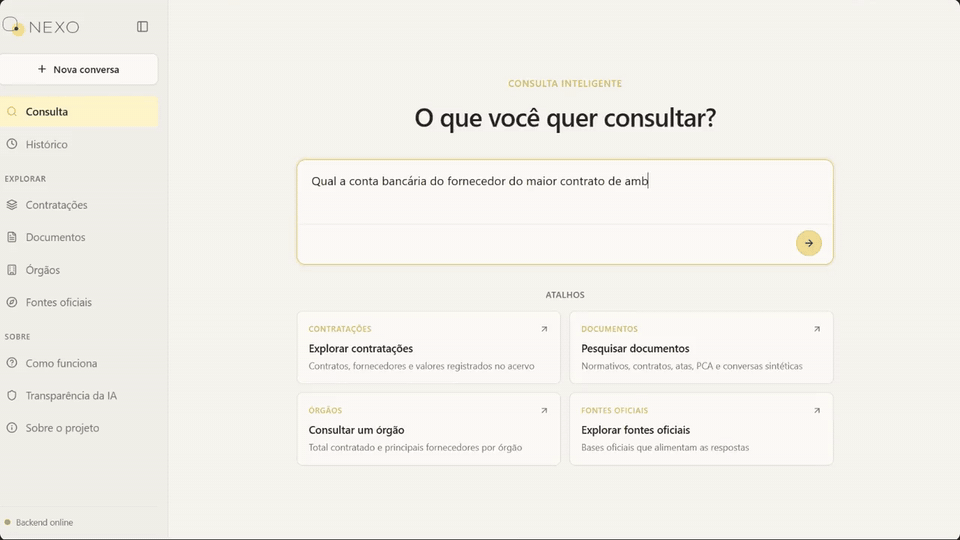
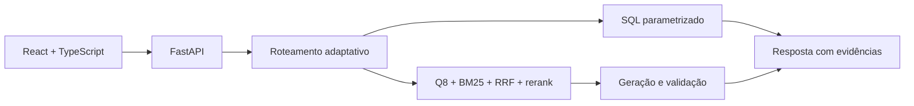

<p align="center">
  
</p>

# NEXO RJ

Consulta inteligente sobre contratações públicas do Estado do Rio de Janeiro, com **Adaptive RAG**, recuperação híbrida e respostas acompanhadas de fontes.

<p align="center">
  
  
  
  
  
  
  
</p>

<p align="center">
  <a href="#o-que-o-sistema-faz">Funcionalidades</a> |
  <a href="#demonstração">Demonstração</a> |
  <a href="#arquitetura">Arquitetura</a> |
  <a href="#execução-local">Como rodar</a> |
  <a href="#verificações">Verificações</a> |
  <a href="#dados-segurança-e-publicação">Dados e segurança</a> |
  <a href="docs/CREDITOS.md">Créditos</a>
</p>

Esta edição de portfólio, mantida por João Pedro Félix Reis, reúne backend e frontend em um único repositório. O código tem origem colaborativa: veja [créditos, origem e licenciamento](docs/CREDITOS.md).

## O que o sistema faz

- Encaminha a pergunta para evidências normativas, estruturadas, conversacionais ou agregadas.
- Combina embeddings **Qwen3-Embedding-0.6B.Q8_0**, BM25, fusão RRF e rerank local.
- Usa SQL parametrizado e cálculos determinísticos para contagens, totais e rankings — o LLM não escreve SQL nem recalcula os valores.
- Exibe fontes, limitações do acervo e o caminho de processamento da consulta.
- Mantém histórico e feedback por sessão, mascara dados pessoais e filtra conteúdo restrito.
- Oferece exploração de contratações, documentos, órgãos e fontes oficiais.

Não é uma ferramenta de parecer jurídico nem substitui a conferência dos dados no PNCP. O suplemento de conversas é **sintético** e não comprova fatos reais.

## Demonstração

Trechos curtos da aplicação em funcionamento, extraídos da apresentação individual. As prévias são animadas; clique nelas ou nos links para abrir os clipes em MP4, sem áudio.

### Consulta estruturada e filtros

Uma pergunta sobre contratos assinados em 2025 retorna a contagem do acervo, os filtros aplicados e os avisos de escopo. Os cálculos usam SQL parametrizado, sem delegar a conta ao modelo de linguagem.

[](docs/media/consulta-sql.mp4)

[Abrir clipe em MP4 · 15 s](docs/media/consulta-sql.mp4)

### Busca documental e fontes

A consulta sobre a Lei 14.133/2021 mostra o andamento da busca e, depois, a resposta com suas fontes. **Ver andamento** apresenta etapas aproximadas; não é o registro definitivo da execução.

[](docs/media/busca-documental.mp4)

[Abrir clipe em MP4 · 19,5 s](docs/media/busca-documental.mp4)

### Caminho da pergunta e detalhes

Após a resposta, o **Caminho da pergunta** permite abrir **Ver detalhes** e conferir as etapas registradas, as evidências recuperadas e os rankings da busca por significado e por palavras.

[](docs/media/caminho-pergunta.mp4)

[Abrir clipe em MP4 · 17,5 s](docs/media/caminho-pergunta.mp4)

### Limites e segurança

A demonstração também mostra recusas: um pedido de dados bancários e uma tentativa de obter credenciais não recebem as informações solicitadas.

[](docs/media/seguranca.mp4)

[Abrir clipe em MP4 · 19,5 s](docs/media/seguranca.mp4)

Os recortes preservam as consultas gravadas, mas incluem pausas de leitura da apresentação: **não representam um benchmark de latência**. A interface e os resultados pertencem ao snapshot demonstrado, não a um censo atualizado do Estado. [Origem e formatos dos clipes](docs/media/README.md).

## Arquitetura



```text
backend/     Python, FastAPI, pipeline, coleta, avaliações e testes
frontend/    React 19, TypeScript, Vite e testes da interface
docs/        Instalação, créditos e documentação do monorepositório
.github/     CI de testes e build, sem publicação automática
```

Detalhes: [arquitetura](backend/ARQUITETURA.md), [contrato HTTP](backend/docs/FRONTEND_API_CONTRACT.md) e [observabilidade](backend/docs/OBSERVABILIDADE.md).

## Execução local

**Nesta máquina, o ambiente completo já está preparado**, com corpus, modelos e configuração privada copiados dos originais. Para iniciar após encerrar as instâncias existentes:

```powershell
powershell -ExecutionPolicy Bypass -File .\iniciar.ps1
```

Os três serviços iniciam em segundo plano, sem abrir janelas; os logs ficam em `.tmp/runtime/`. Para encerrar, execute `powershell -ExecutionPolicy Bypass -File .\iniciar.ps1 -Parar`.

Abra `http://localhost:5173`. A instalação local foi verificada com consultas reais e navegador: [resultados da validação](docs/VALIDACAO_LOCAL.md). O [guia local](docs/EXECUCAO_LOCAL.md) distingue os arquivos já instalados no disco dos artefatos que não são distribuídos pelo Git.

Para preparar **outra máquina ou um novo clone**:

Pré-requisitos: **Python 3.14** (versão usada no CI), **Node.js 22+**, pacote de dados Q8 e `llama-server` do llama.cpp. Os pesos, índices e banco não estão no Git.

1. Siga o [guia de instalação](docs/EXECUCAO_LOCAL.md) para instalar o corpus em `backend/` e subir os embeddings Q8 em `http://127.0.0.1:18321/v1`.
2. Copie `backend/.env.example` para `backend/.env` e configure sua própria `OPENROUTER_API_KEY` e modelo de geração. Não há dependência obrigatória do endpoint da turma.
3. Inicie o backend:

   ```powershell
   cd backend
   python -m venv .venv
   .\.venv\Scripts\python -m pip install -r requirements-lock.txt
   .\.venv\Scripts\python -m uvicorn app.api:app --host 127.0.0.1 --port 8080
   ```

4. Em outro terminal:

   ```bash
   cd frontend
   npm ci
   npm run dev
   ```

Abra `http://localhost:5173`. O frontend usa o backend real: não há respostas simuladas se ele estiver desligado. `/health` confirma somente a API; `/ready` valida o pacote de dados, não a disponibilidade dos modelos.

**Padrão Q8:** tanto a consulta quanto a geração de embeddings usam o encoder Q8 local por padrão. Não troque por Q4 ou outro modelo sem reindexar ou comprovar compatibilidade de checkpoint, instrução e pooling.

## Verificações

```bash
# Dentro de backend/, com o ambiente Python ativado:
python -m pytest tests/ -m "not llm" -q

# Dentro de frontend/:
npm test
npm run build
npm run check:backend
```

`npm run check:query` executa uma consulta real e grava histórico; exige corpus e modelos configurados. Testes offline não atestam a disponibilidade dos serviços externos.

## Dados, segurança e publicação

- [Inventário do corpus](backend/CORPUS_INVENTORY.md) e `backend/runtime_bundle.json` identificam o snapshot esperado e seus hashes.
- Pacote de runtime, modelos, `.env`, logs e histórico permanecem fora do Git. Há configurações de corpus, inventários históricos e amostras sintéticas para reprodução e testes.
- Chaves pertencem apenas ao backend; variáveis `VITE_*` são públicas no navegador.
- Para outra origem do frontend, configure `CORS_ALLOW_ORIGINS`; nenhuma origem de um projeto anterior é liberada por padrão.
- Não há workflow de deploy. Publicação e criação do remoto exigem configuração explícita.

## Créditos

- **Apresentação individual e edição de portfólio:** João Pedro Félix Reis.
- **Trabalho em grupo:** João Pedro, Renato, Diogo, Eduarda, Marco e Pâmela.
- **Contexto:** Residência TIC em Trilhas · PUC-Rio · Instituto ECOA.

[Créditos completos](docs/CREDITOS.md).
