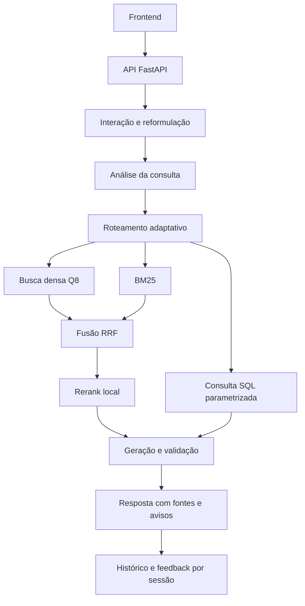

# Arquitetura — NEXO RJ

## Visão geral

O monorepositório contém uma interface React/TypeScript em `../frontend/` e uma API FastAPI neste diretório. O domínio é a consulta verificável de contratações públicas do RJ, com roteamento por tipo de evidência.

## Consulta

1. **Interação e reformulação:** saudações e pedidos fora do escopo podem receber resposta sem consulta ao acervo. Continuação de conversa usa o histórico enviado pelo cliente, com regras locais e LLM quando necessário.
2. **Análise:** extrai filtros de ano/período, valor, órgão, município, esfera, modalidade e fornecedor. A análise padrão usa regras determinísticas; análise por LLM é opcional.
3. **Roteamento:** seleciona bases normativas, estruturadas, conversacionais ou agregadas antes da busca.
4. **SQL:** usa consultas predefinidas e parametrizadas; o LLM nunca escreve SQL. Resultados analíticos suficientes dispensam recuperação. O backend preserva os valores calculados, com apresentação determinística por padrão. Quando habilitada, a apresentação por LLM usa um marcador `{{sql}}`, substituído pelo resultado completo após validação do template.
5. **Busca híbrida:** combina embeddings Q8 e BM25, funde por RRF e reordena candidatos com cross-encoder local. Filtros e limites por compra evitam evidências redundantes.
6. **Geração:** recebe evidências limitadas por orçamento de contexto. A validação filtra citações inexistentes, respostas inválidas e dados sensíveis. Respostas incluem fontes, confiança e avisos de escopo.

Perdas de disponibilidade devem aparecer como erro, recusa ou degradação explícita; nunca como uma resposta simulada.

## Camadas

| Camada | Local |
| --- | --- |
| Domínio puro | `src/domain/`, `src/schema.py` |
| Caso de uso | `src/pipeline.py` |
| Contratos de dependência | `src/ports.py` |
| Recuperação | `src/retrieve.py`, `src/retrieval/`, `src/lexical_index.py` |
| SQL | `src/structured_db.py`, `src/structured_query.py`, `src/sql_query/` |
| Geração | `src/generate.py`, `src/generation/`, `llm_ecoa.py` |
| HTTP e CLI | `app/api.py`, `app/cli.py` |
| Observabilidade | `src/obs.py`, `src/log_store.py`, `src/trace.py` |

O nome histórico `llm_ecoa.py` e o preset legado `ecoa` foram mantidos para compatibilidade dos imports e contratos. Isso não implica uso do servidor institucional: a geração padrão usa OpenRouter e os embeddings padrão usam llama.cpp local.

O domínio não depende de banco, índice ou cliente HTTP. `tests/test_architecture.py` verifica os limites. O pipeline permite substituição de dependências por `Dependencias`; exemplos estão em `tests/test_pipeline_ports.py`.

## Modelos e corpus

- Encoder padrão: **Qwen3-Embedding-0.6B.Q8_0**, servido em `http://127.0.0.1:18321/v1`, pooling `last`.
- O mesmo preset configura consulta, `src.create_embeddings`, `src.index` e o construtor direto. No padrão local, uma falha do Q8 não aciona outro encoder. O fallback histórico do construtor direto só existe quando o preset legado é selecionado explicitamente.
- Snapshot esperado: `v7-qwen-q8-2026-10-26`, descrito em [runtime_bundle.json](runtime_bundle.json).
- Código e manifesto não substituem o pacote de dados: documentos, SQLite e índices são externos ao Git.
- `src.snapshot` valida hashes, IDs, cobertura, SQL e catálogo sem reconstruir ou promover dados automaticamente.
- Configurações de coleta, inventários históricos, manifests e amostras sintéticas são preservados para reprodução e testes; não são o corpus de runtime completo.

Veja [CORPUS_INVENTORY.md](CORPUS_INVENTORY.md) e o [guia de instalação](../docs/EXECUCAO_LOCAL.md). Não misture outro modelo com os vetores existentes, mesmo com dimensão igual.

## Segurança e estado

- `src/sensitivity.py` mascara dados pessoais; chunks restritos não chegam ao modelo. Conversas sintéticas são identificadas como fictícias.
- Histórico e traces exigem `X-Session-Id` do dono ou `X-API-Key` de operação. `HISTORY_PUBLIC` permanece desligado.
- CORS permite somente as duas origens locais do Vite e as origens explicitamente configuradas em `CORS_ALLOW_ORIGINS`.
- Chaves, logs e histórico SQLite não são versionados. A retenção é configurável.
- Rate limiting e cabeçalhos de segurança são aplicados na API. Documentação HTTP pode ser desligada em uma exposição pública.

## Observabilidade e verificação

Envelopes de API e pipeline correlacionam `run_id`, `query_id` e `session_id`. Etapas não executadas e fallbacks ficam explícitos. O trace diferencia o tempo total das latências de etapas sobrepostas; o log mascara informações sensíveis e pode manter cadeia de hashes.

Detalhes em [OBSERVABILIDADE.md](docs/OBSERVABILIDADE.md) e no [contrato HTTP](docs/FRONTEND_API_CONTRACT.md).

Os testes offline usam fixtures e não dependem do corpus completo nem de serviços de modelos. Avaliações reais exigem a configuração de runtime. Medições históricas preservadas em `docs/` não constituem uma nova verificação desta edição.
